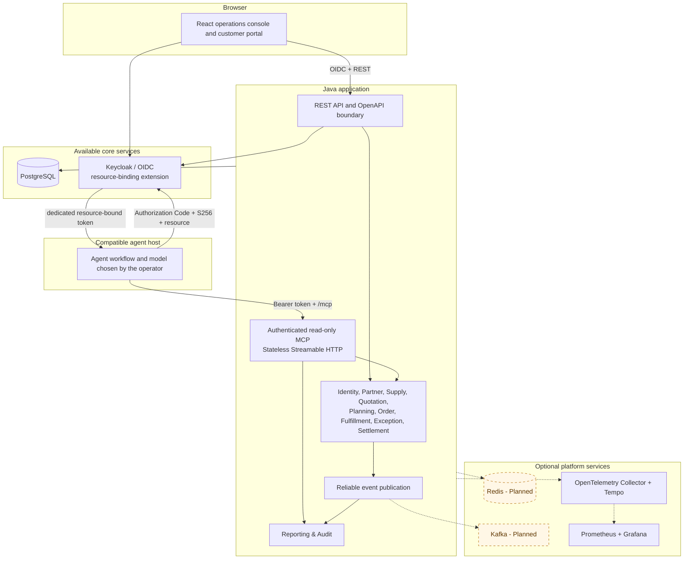
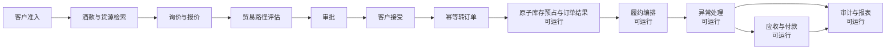
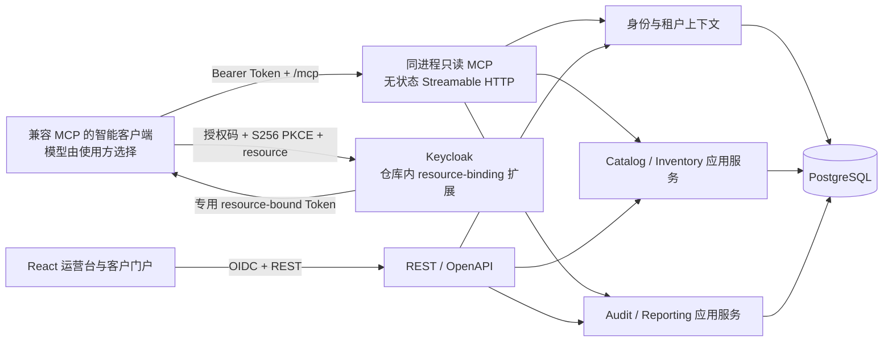

# CellarBridge

**An explainable B2B wine trade orchestration platform, from quotation to delivery.**  
**一个从询报价到交付的可解释酒饮 B2B 贸易协同平台。**

[English](#english) · [简体中文](#简体中文)

> **Current main — authenticated read-only MCP plus hardened public quotation links.** `/mcp` combines permission-filtered operations, strict Envelope 2.0 schemas, signed cursors, truthful freshness, dedicated OAuth/PKCE/resource binding and fail-closed admission controls. Public quotation capability URLs use monotonic GCRA admission with a quota-derived dynamic recovery time and bounded telemetry.
> **当前 main — 已提供认证只读 MCP，并加固公开报价链接。** `/mcp` 将权限过滤、严格 Envelope 2.0 schema、签名分页、真实 freshness、专用 OAuth/PKCE/resource 绑定和 fail-closed 准入组合为一个标准入口；公开报价 capability URL 使用单调时钟 GCRA、按配额计算的动态恢复时间与有界观测。
> **Release boundary:** `v1.0.0` predates MCP; its deterministic demo still covers quotation, reservation, recovery, settlement and audit.
> **发布边界：** `v1.0.0` 不含 MCP；详见[发行说明](docs/05-delivery/25-release-notes-v1.0.0.md)和[项目指南](docs/reviewer-guide.md)。

## MCP protocol quick check / MCP 协议快速检查

After `make dev-core`, obtain a demo OIDC token through the [MCP runbook](docs/05-delivery/26-mcp-agent-runbook.md), then call `tools/list` to inspect all six strict `outputSchema` definitions. Never put tokens or cursors in URLs, committed files, screenshots, logs, or issue text.
执行 `make dev-core` 后，按 [MCP 运行手册](docs/05-delivery/26-mcp-agent-runbook.md)取得演示 OIDC token，再调用 `tools/list` 检查六个严格 `outputSchema`。
token 和 cursor 不得进入 URL、提交文件、截图、日志或 issue 文本。

```bash
curl http://localhost:8080/mcp \
  -H "Authorization: Bearer $CB_ACCESS_TOKEN" \
  -H "Origin: http://localhost:5173" \
  -H "Content-Type: application/json" \
  -H "Accept: application/json, text/event-stream" \
  -H "MCP-Protocol-Version: 2025-11-25" \
  --data '{"jsonrpc":"2.0","id":1,"method":"tools/list","params":{}}'
```

---

## English

### 1. Why this project exists

CellarBridge models a realistic target workflow for a wine importer and B2B supply-chain operator. It is not a consumer storefront and it is not a collection of disconnected CRUD screens. The executable scope currently runs from customer eligibility and supply search through quotation, idempotent order creation, Inventory-owned reservation, Fulfillment, exception recovery, permission-scoped receivables, and eventually consistent audit/reporting projections.

### 2. Core business scenario

In the target scenario, a sales representative prepares a customer-specific quotation for several wine SKUs. The platform evaluates eligible delivery routes, explains why each route is accepted or rejected, calculates a versioned price breakdown, and requests approval when margin or discount policies are exceeded. The executable core continues through customer acceptance, exactly-one-order creation, atomic Inventory reservation, route-specific Fulfillment, source-verified exception recovery, and fulfillment-triggered receivables with external payment and reversal evidence. Those reliable business events feed tenant-scoped audit, timeline, work-item, and metric projections.

```mermaid
flowchart LR
    A[Partner onboarding] --> B[Catalog and supply search]
    B --> C[Quotation]
    C --> D[Trade-route evaluation]
    D --> E[Approval]
    E --> F[Customer acceptance]
    F --> G[Idempotent order conversion]
    G --> H[Atomic reservation + order outcome<br/>Available]
    H --> I[Fulfillment orchestration<br/>Available]
    I --> J[Exception handling<br/>Available]
    J --> K[Receivable and payment<br/>Available]
    J --> L[Audit and reporting<br/>Available]
    K --> L
```



### 3. Product capabilities

| Capability                                         | Business value                                                                                                                              | Baseline state |
| -------------------------------------------------- | ------------------------------------------------------------------------------------------------------------------------------------------- | -------------- |
| Identity, tenant and permission access             | Establishes a non-forgeable tenant context and protected operations navigation                                                              | Available      |
| Partner onboarding and channel eligibility         | Prevents transactions with inactive or ineligible customers                                                                                 | Available      |
| Wine product, SKU, lot, and supply-pool search     | Preserves vintage, package, provenance, availability semantics, and field-level visibility                                                  | Available      |
| Quotation, route and customer decision             | Freezes terms, explains route ranking, enforces approval, and preserves idempotent acceptance/rejection                                     | Available      |
| Order and inventory correctness                    | Creates at most one order, propagates verified decisions, preserves units and proves no-oversell reservation                               | Available      |
| Fulfillment, exception and settlement              | Applies versioned plans, source-verified recovery, and immutable receivable/payment/reversal evidence                                      | Available      |
| Audit trail and operational read models            | Supports immutable evidence, unified timelines, actionable work queues, and permission-filtered dashboards                                  | Available      |
| Production-oriented MCP hardening and agent workflows | Adds standards discovery, dedicated PKCE/resource binding, typed bounded reads, bounded overload controls and safe diagnostics for compatible agent hosts | Available      |
| Operational assurance evidence                     | Combines trace/metrics, threat/SBOM/container gates, versioned performance data, concurrency invariants and controlled outage recovery      | Available      |

### 4. Architecture at a glance

CellarBridge starts as a **domain-oriented modular monolith**. This is a deliberate choice: the business needs strong consistency inside aggregates, clear module ownership, simple local execution, and credible extraction paths—not distributed-system ceremony before it is justified.



The principal architecture rules are:

- business modules communicate only through published module APIs and versioned events;
- each module owns its tables and migrations; cross-module foreign keys are avoided;
- accepted quotations and orders store immutable commercial snapshots;
- critical commands are idempotent and use database constraints as the final guard;
- inventory correctness never depends on cache or distributed locks;
- external event delivery is at-least-once, so consumers must be idempotent;
- PostgreSQL search is preferred over a separate search cluster for the expected catalog size;
- every architectural exception requires an Architecture Decision Record.

### 5. What AI Agents can do now

The current main line exposes an **authenticated, read-only Operations MCP** at `/mcp`. A compatible
AI Agent host can assemble a daily operations brief, research permission-filtered supply, or trace
business history without receiving a parallel identity system or privileged data path. Every tool
and resource request revalidates the Bearer token and rebuilds the tenant context; prompts are
fixed workflow instructions and never execute tools by themselves.

| MCP surface | Available capabilities |
| --- | --- |
| 6 read-only tools | `cellarbridge_current_user`, `cellarbridge_search_supply`, `cellarbridge_list_work_items`, `cellarbridge_get_dashboard`, `cellarbridge_get_timeline`, `cellarbridge_search_audit` |
| 1 fixed resource + 2 templates | `cellarbridge://session/me`, `cellarbridge://catalog/skus/{skuId}`, `cellarbridge://timeline/{subjectType}/{subjectId}` |
| 3 prompts | `cellarbridge_daily_operations_brief`, `cellarbridge_supply_search_brief`, `cellarbridge_trace_business_history` |
| Machine-readable result contract | Envelope `2.0`; strict JSON Schema 2020-12 output per tool; structured warning codes and safe errors |
| Complete bounded reads | Signed cursors for supply, work items, timeline, and audit; 15-minute default TTL; 256 KiB/1,000 nested collection-item default budget |
| Truthful freshness | Reporting uses source watermark/checkpoint evidence; supply reports `OBSERVATION_AGE/UNKNOWN` instead of claiming projector health |
| OAuth boundary and runtime controls | RFC 9728 metadata/challenges; dedicated HTTPS resource, audience, `mcp:read` scope and public host client; real Code + S256 PKCE; RFC 8707 authorization/token/refresh binding; body, token-bucket, bulkhead, request/SQL timeout, low-cardinality metrics and separate MCP health |

This interface cannot submit or approve quotations, reserve or release inventory, advance
fulfillment, recover exceptions, record payments, reverse transactions, rebuild projections, or
perform any other write. CellarBridge bundles no model, provider SDK, autonomous approval loop, RAG,
vector database or persistent memory; DCR, token exchange and credential forwarding are unsupported.
Keycloak 26.7 needs the repository provider and otherwise fails closed; the operator supplies the host/model. See the [capability contract](docs/04-contracts/10-mcp-capability-contract.md), [runbook](docs/05-delivery/26-mcp-agent-runbook.md), and [evidence](docs/evidence/mcp/conformance-summary.md).

### 6. Technology baseline

The executable baseline uses Java 21, Spring Boot/Modulith/Security/JDBC, PostgreSQL/Flyway,
Keycloak/OIDC, React/TypeScript/Vite, OpenAPI, Spring AI MCP, OpenTelemetry and the Maven/pnpm
toolchains. Testcontainers, ArchUnit, Playwright, SBOM and container gates make the boundary
repeatable. Exact current versions and planned targets live in the
[technology baseline](docs/03-architecture/13-technology-baseline.md); Kafka and Redis remain
planned and are absent from the runtime.

### 7. What is technically distinctive

**Business correctness before framework code.** Aggregates define explicit state transitions and invariants. Monetary values never use floating-point types. Time comes from an injected clock. Accepted commercial data is never recalculated silently.

**Explainable route decisions.** The trade-planning engine rejects invalid routes with machine-readable reason codes and scores valid routes using versioned policies. A manager may override a recommendation only with a recorded reason.

**Concurrency demonstrated through reservation execution.** Task 08 B1 combines deterministic candidate locking with exact PostgreSQL conditional updates. Controlled contention proves no oversell and multi-line rollback. B2 serializes competing outcomes under the Trade Order row lock, validates request/decision hashes, and preserves the first terminal result across duplicate or out-of-order delivery.

**Reliable asynchronous collaboration.** The current core uses persisted local event publications and idempotent Consumer Inbox handlers. Correlation and causation identifiers remain business evidence; W3C trace context is stored in event metadata and asynchronous consumers use span links rather than false synchronous parentage.

**Admission control matched to the traffic boundary.** Public quotation links use monotonic-time GCRA instead of a fixed minute window, preventing boundary double bursts while returning a dynamic `Retry-After`. Reads have an independent 120/minute budget; accept and reject share a 30/minute decision budget. Malformed tokens map to 64 fixed buckets per scope (128 total), active state is capped at 10,000 with fail-closed admission, and metrics expose only bounded labels. This state is process-local, so an `N`-replica deployment can admit up to `N` times the configured capability budget and still requires edge-source limiting. MCP retains its token bucket for its different controlled-client burst profile.

**Architecture as an executable constraint.** Current Spring Modulith and ArchUnit tests enforce module cycles, internal-package boundaries, selected dependency directions, and domain isolation. Remaining fitness functions are explicitly marked partial or planned.

**AI Agent access without a privileged back door.** The MCP adapters call the same permission-aware
application services as the REST boundary. They cannot accept tenant, actor, role, permission,
partner, or warehouse scope from tool arguments. Strict schemas, signed cursor pagination,
freshness evidence, bounded queries and bounded serialization make complete reads machine-checkable.
Dedicated OAuth binding keeps API and agent tokens distinct; admission controls bound MCP overload on the shared runtime, while safe metrics and MCP health never turn identities or payloads into labels.

### 8. Repository map

| Path | Purpose |
| --- | --- |
| `backend/`, `frontend/` | Spring Boot modular monolith and React operations console |
| `contracts/`, `deploy/` | Versioned interfaces and core/observable Compose profiles |
| `docs/00-research`–`05-delivery` | Evidence, product, domain, architecture, contracts and delivery |
| `scripts/`, `.github/` | Repeatable local verification and repository workflows |

### 9. Run current main locally

For the packaged demonstration, install Docker Desktop (or Docker Engine) with Compose and run:

```bash
make demo                         # deterministic core: PostgreSQL, Keycloak, backend, frontend
make demo DEMO_PROFILE=full       # add Collector, Tempo, Prometheus and Grafana; requires .env
make demo-reset                   # destroy only cellarbridge-demo synthetic volumes and reseed
make demo-e2e                     # run the complete reviewer journey and capture release evidence
make stop-demo
```

`make demo` validates pinned inputs, migrates and seeds, waits for health, then prints URLs and roles.
Reset is restricted to the `cellarbridge-demo` project; full requires an untracked `.env`.
Production has no default database or cursor-signing secret.

Source verification requires Java 21, Node.js 24, Corepack/pnpm 11 and Python 3.12. Wrappers and lockfiles fix build inputs; `make help` lists all commands. The minimum gate is `make validate`,
`make test` and `make mcp-production-security`.

After `make dev-core`, use <http://localhost:5173/app>; readiness and Keycloak run on ports 8080 and
8081. The printed synthetic credentials are demo-only. Stop with `make stop-core`; procedures are
indexed in [delivery documentation](docs/05-delivery/), with MCP setup, evidence and rollback in the
[MCP and agent runbook](docs/05-delivery/26-mcp-agent-runbook.md).

[OpenAPI](contracts/openapi/cellarbridge-api.yaml) owns REST and generated TypeScript;
[implementation status](docs/05-delivery/10-implementation-status.md) owns executable inventory.

### 10. Delivery status

The [implementation status](docs/05-delivery/10-implementation-status.md) is the single source for
capability states and evidence; the [roadmap](docs/05-delivery/00-implementation-roadmap.md) defines
sequencing. Planned work must never be presented as delivered.

The current main line includes MCP; the immutable `v1.0.0` release does not. The product remains
bounded: payments and carriers are simulated; PostgreSQL local publication is deployed; Kafka and
Redis are absent; reporting is eventually consistent; single-host results are not production SLAs.
MCP is read-only with a dedicated resource/audience/scope/client, and the repository-owned Keycloak
provider is an explicit deployment and rollback boundary.

### 11. Disclaimer

CellarBridge is an independent technical demonstration based on public business information and general supply-chain domain analysis. It is not an official product of Chengdu Fine West International Trade Co., Ltd., FineWest, WineMatcher, or any related brand. Company and brand names appear only in the research record. All customers, products, prices, inventory, orders, and operational events used by the project are synthetic.

---

## 简体中文

### 1. 项目定位

CellarBridge（酒桥）模拟一家进口酒饮供应链服务商的目标企业流程。它不是面向消费者的酒类商城，也不是把若干 CRUD 页面拼在一起的后台模板。当前主线可运行闭环从客户准入、报价与路径决策继续延伸到唯一订单、库存预占、路线绑定履约、异常恢复、应收、审计与经营报表，并提供可追踪本地事件、运营指标、可复现观测环境和供应链安全门禁。当前主线还提供经过认证的只读 MCP，使兼容 MCP 的智能客户端能够在原有权限边界内读取运营上下文；已发布的 `v1.0.0` 标签早于该能力，不包含 MCP。

### 2. 核心业务场景

在目标场景中，销售人员为商业客户选择多个酒款 SKU，并生成客户专属报价。系统根据客户资格、货源位置、目标交付时间、交付区域和成本构成评估可用的贸易交付路径；每个候选方案都给出可解释的通过、拒绝原因和评分。当前可执行核心继续覆盖审批、客户接受、唯一订单创建、Inventory 原子预留、路线专属履约、源状态验证的异常恢复，以及履约完成后自动应收、部分/全额付款和部分冲正；可靠业务事件继续投影为审计、统一时间线、工作项与指标。



### 3. 产品能力

| 能力                        | 解决的问题                                                                           | 基线状态 |
| --------------------------- | ------------------------------------------------------------------------------------ | -------- |
| 身份、租户与权限访问        | 建立不可伪造的租户上下文和受保护的运营导航                                           | 可运行   |
| 商业客户准入与渠道资格      | 防止未激活、已停用或不具备交付资格的客户参与交易                                     | 可运行   |
| 酒款、SKU、批次与货源池检索 | 准确表达年份、包装、来源、库存位置、非承诺可用性和字段权限                           | 可运行   |
| 报价、路径与客户决定        | 固化商业条件、解释路径评分、执行审批并保存幂等接受/拒绝事实                          | 可运行   |
| 订单与库存正确性            | 保证唯一订单、传播决策证据、保留单位语义并以原子预占防止超卖                        | 可运行   |
| 履约、异常与结算            | 应用版本化计划、执行源状态验证恢复并保存不可变应收、付款与冲正证据                  | 可运行   |
| 审计与经营读模型            | 提供不可变证据、统一时间线、工作队列和权限过滤经营看板                               | 可运行   |
| 面向生产约束加固的 MCP 与智能工作流 | 为兼容智能客户端提供标准发现、专用 PKCE/resource 绑定、强类型有界读取、有界过载控制与安全诊断 | 可运行   |
| 运行保障证据                | 汇总 trace/指标、安全供应链门禁、版本化性能数据、并发不变量与受控故障恢复            | 可运行   |

### 4. 架构概览

项目采用**领域驱动的模块化单体**作为起点。这不是对微服务能力的回避，而是基于当前业务规模、团队协作、事务边界和演示可运行性做出的工程判断。系统先通过明确模块边界、独立数据归属、可靠事件和架构测试获得可拆分性；只有在独立扩缩容、发布节奏、团队所有权或故障隔离确有需要时，才考虑提取服务。



核心规则如下：

- 模块之间只能通过公开模块接口和版本化事件协作；
- 每个模块拥有自己的表和迁移，原则上不建立跨模块外键；
- 已接受报价与订单保存不可变商业快照，不依赖后续商品或价格数据；
- 高风险命令必须支持幂等，最终防线是数据库唯一约束；
- 库存正确性不依赖缓存，也不依赖分布式锁；
- 外部事件按至少一次语义交付，消费端必须去重；
- 预期酒款规模优先使用 PostgreSQL 搜索能力，不为少量数据单独维护搜索集群；
- 任何突破边界的决定都必须通过 ADR 记录背景、取舍和后果。

### 5. AI Agent（智能体）当前可以做什么

当前主线在 `/mcp` 提供**经过认证、只读、权限感知的 Operations MCP**。兼容 MCP 的 AI Agent
可以组织每日运营简报、检索权限范围内的供给信息，或追溯业务对象历史，而不会获得一套平行身份
体系或越权数据通道。每次 Tool 与 Resource 调用都会重新校验 Bearer Token 并建立租户上下文；
Prompt 只是固定工作步骤，不会自行执行 Tool。

| MCP 能力面 | 当前可用能力 |
| --- | --- |
| 6 个只读 Tools | `cellarbridge_current_user`、`cellarbridge_search_supply`、`cellarbridge_list_work_items`、`cellarbridge_get_dashboard`、`cellarbridge_get_timeline`、`cellarbridge_search_audit` |
| 1 个固定 Resource + 2 个 Templates | `cellarbridge://session/me`、`cellarbridge://catalog/skus/{skuId}`、`cellarbridge://timeline/{subjectType}/{subjectId}` |
| 3 个 Prompts | `cellarbridge_daily_operations_brief`、`cellarbridge_supply_search_brief`、`cellarbridge_trace_business_history` |
| 可机器消费的结果合同 | Envelope `2.0`；逐 Tool 的严格 JSON Schema 2020-12；结构化 warning code 与安全错误 |
| 完整且有界的读取 | 供给、工作项、时间线、审计均使用签名 cursor；默认 TTL 15 分钟；默认 256 KiB/1,000 个嵌套集合元素预算 |
| 诚实的新鲜度 | Reporting 使用 source watermark/checkpoint；Supply 返回 `OBSERVATION_AGE/UNKNOWN`，不伪称 projector 健康 |
| OAuth 边界与运行控制 | RFC 9728 metadata/challenge；专用 HTTPS resource、audience、`mcp:read` scope 与 public host client；真实授权码 + S256 PKCE；RFC 8707 授权/换令牌/刷新绑定；请求体、token-bucket、bulkhead、请求/SQL 超时、低基数指标与独立 MCP health |

这个接口不能审批报价、操作库存、推进履约、恢复异常、登记或冲正付款、重建投影或执行其他写操作。
CellarBridge 不内置模型、供应商 SDK、自主审批、RAG、向量库或持久记忆，也不支持 DCR/token exchange/credential forwarding。
Keycloak 26.7 必须显式启用仓库内 provider，否则 MCP 令牌边界 fail closed；使用方自行选择客户端与模型。详见
[MCP 能力合同](docs/04-contracts/10-mcp-capability-contract.md)、[运行手册](docs/05-delivery/26-mcp-agent-runbook.md)和 [验证证据](docs/evidence/mcp/conformance-summary.md)。

### 6. 技术栈基线

可执行基线采用 Java 21、Spring Boot/Modulith/Security/JDBC、PostgreSQL/Flyway、
Keycloak/OIDC、React/TypeScript/Vite、OpenAPI、Spring AI MCP、OpenTelemetry 与 Maven/pnpm
工具链，并由 Testcontainers、ArchUnit、Playwright、SBOM 和容器门禁复验。精确版本和计划目标以
[技术基线](docs/03-architecture/13-technology-baseline.md)为准；Kafka、Redis 仍是计划项，
当前运行环境未安装。

### 7. 技术亮点

**业务正确性优先。** 聚合显式维护状态迁移和不变量；金额禁止使用浮点数；时间通过 `Clock` 注入；报价接受后不得静默重新计价；订单取消、库存释放和付款冲正都有明确边界。

**决策过程可解释。** 贸易路径引擎先执行硬约束，再对合格方案评分。每个拒绝原因和得分项都可以展示、审计和测试。人工覆盖推荐结果时必须填写理由，并保存使用的策略版本。

**并发正确性已在预留执行链路获得证明。** Task 08 B1 将确定性候选锁定与 PostgreSQL 精确条件更新组合起来，证明不会超卖并能整单回滚。B2 在 Trade Order 行锁内串行化竞争结果，校验请求与决策哈希，并在重复或乱序投递下保留首个终态。

**异步协作可恢复且可追踪。** 当前 core 使用持久化本地发布记录和幂等 Consumer Inbox，保留 correlation/causation 业务证据，并在事件 metadata 传播 W3C trace context；异步消费者使用 span link，不伪造同步父子关系。

**按流量边界选择准入算法。** 公开报价链接使用单调时钟 GCRA 取代固定分钟窗口，消除窗口边界双突发，并返回动态 `Retry-After`。读取额度独立为每分钟 120 次，接受与拒绝共享每分钟 30 次的决定额度；非法 token 在每个 scope 只映射到 64 个固定桶（合计最多 128 个），活跃状态最多 10,000 个且容量满时 fail closed，指标只使用有界标签。该状态是进程内的，部署 `N` 个副本时 capability 总额度最多放大 `N` 倍，仍需保留边缘来源限流；MCP 则因受控客户端的突发特征继续使用 token bucket。

**架构约束可执行。** 当前 Spring Modulith 和 ArchUnit 测试验证模块循环、internal 包边界、部分依赖方向和领域隔离；其余适应度函数明确标记为部分可用或计划中。

**智能客户端没有越权后门。** MCP 适配器调用与 REST 相同的权限感知应用服务，Tool 参数不能接收
tenant、actor、role、permission、Partner 或仓库范围。严格 schema、签名 cursor、freshness
evidence、有界查询与有界序列化，让完整读取可以被机器校验。专用 OAuth 区分 API 与智能客户端
Token，准入控制约束共享运行时过载；安全指标与 MCP health 不以身份或业务 payload 为维度。

### 8. 运行当前主线

启动、重置、源码版本和最低门禁与英文[本地运行说明](#9-run-current-main-locally)共用；完整
命令以 `make help` 为准。生产配置不提供数据库或 cursor secret 默认值，demo 合成账号和密码
严禁复用。运行流程见[交付文档](docs/05-delivery/)；MCP 配置、权限、证据和回滚见
[MCP 运行手册](docs/05-delivery/26-mcp-agent-runbook.md)。REST 接口以
[OpenAPI](contracts/openapi/cellarbridge-api.yaml)为准，能力清单以
[实现状态](docs/05-delivery/10-implementation-status.md)为准。

### 9. 当前进度

[实现状态](docs/05-delivery/10-implementation-status.md)是能力状态与证据的单一事实源，
[路线图](docs/05-delivery/00-implementation-roadmap.md)只定义实施顺序；尚未验证的能力不得
标为已交付。

版本边界保持明确：当前主线包含 MCP，不可变的 `v1.0.0` 不包含。付款与承运商为模拟适配器；
事件路径是 PostgreSQL 本地 publication；无 Kafka/Redis；报表最终一致；MCP 只读并使用专用
resource/audience/scope/client；仓库内 Keycloak provider 是部署与回滚边界；单机结果不是生产 SLA。

### 10. 非官方声明

CellarBridge 是基于公开商业信息和通用供应链领域分析构建的独立技术演示项目，与成都优自西方国际贸易有限公司、FineWest、WineMatcher 或相关品牌不存在隶属、授权或合作关系。公司及品牌名称只出现在调研记录中。项目中的客户、酒款、价格、库存、订单和履约事件均为合成数据。
